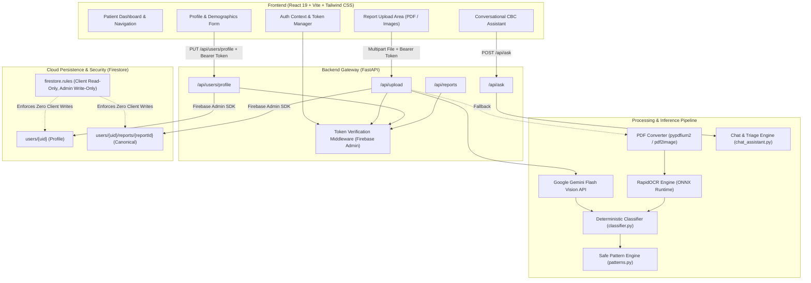

<div align="center">

# 🩺 Reportly (रिपोर्टली)
### Intelligent Clinical Laboratory Intelligence & Complete Blood Count (CBC) Decoder

[](https://fastapi.tiangolo.com)
[](https://react.dev)
[](https://vitejs.dev)
[](https://www.python.org)
[](https://firebase.google.com)
[](https://github.com/RapidAI/RapidOCR)
[](https://ai.google.dev)
[](https://docs.pytest.org)
[](LICENSE)

<p align="center">
  <b>Transforming complex, opaque Complete Blood Count (CBC) laboratory panels into clear, structured, mathematically validated clinical insights with zero-hallucination guarantees and non-diagnostic safety guardrails.</b>
</p>

[Key Features](#-key-features) •
[System Architecture](#-system-architecture) •
[Tech Stack](#-technology-stack) •
[Installation & Setup](#-installation--quick-start) •
[API Reference](#-api-specification) •
[Security & Rules](#-security--data-privacy) •
[Verification & Tests](#-testing--quality-assurance)

---

</div>

## 📌 Executive Summary

Modern medical laboratory reports are dense, jargon-laden, and difficult for patients to interpret. Patients frequently turn to unconstrained generative AI tools that risk hallucinating medical facts, providing false reassurances, or fabricating diagnostic conclusions.

**Reportly** bridges the communication divide between diagnostic laboratories and patients. Designed with a **safety-first, zero-hallucination paradigm**, Reportly ingests PDF documents and lab photographs, extracts laboratory biomarkers via hybrid OCR/vision models, executes **strictly deterministic mathematical reference-range checks**, highlights recognized clinical biomarker patterns, and provides medically vetted discussion questions for physician consultations.

> [!IMPORTANT]
> **Clinical Non-Diagnostic Mandate**: Reportly is an educational lab literacy and clinical empowerment tool. It **never** provides definitive diagnoses, confirms illnesses, prescribes medicines or dosages, or replaces consultation with a qualified medical professional.

---

## ✨ Key Features

### 🔬 1. Dual-Path Hybrid Extraction Engine
- **Cloud Multimodal Vision (Google Gemini Flash)**: Ingests raw lab scans and PDFs with complex multi-column layouts, extracting patient demographics, lab metadata, numerical results, and printed reference intervals.
- **Edge / Offline OCR Engine (RapidOCR ONNX Runtime)**: Fallback local optical character recognition running ONNX models directly on the host machine. Converts PDF pages into high-resolution images via `pypdfium2` / `pdf2image`, performing spatial line-box analysis and contextual token lookahead without requiring cloud API availability.

### 📐 2. Deterministic Reference-Range Classifier
- **Zero LLM Hallucination on Clinical Numbers**: Natural language models are **strictly forbidden** from determining whether a parameter is Normal, Low, or High.
- **Strict Mathematical Interval Comparison**: Values are parsed as IEEE floating-point numbers and compared against laboratory-printed lower and upper bounds ($[\text{Min}, \text{Max}]$):
  $$\text{Status} = \begin{cases} 
  \text{Low} & \text{if } v < \text{Min} \\ 
  \text{High} & \text{if } v > \text{Max} \\ 
  \text{Within Range} & \text{if } \text{Min} \le v \le \text{Max} \\ 
  \text{Needs Verification} & \text{if unparseable or ambiguous} 
  \end{cases}$$
- **Canonical Unit Normalization**: Standardizes diverse lab notations across global standards (`g/dL`, `gm/dl`, `10^3/µL`, `/cumm`, `cells/mm3`, `10^6/µL`, `fL`, `pg`, `%`).

### 🔍 3. Evidence Trace & Transparency Audit
- Every extracted parameter features a full audit trail (**Evidence Trace Modal**):
  - **Source OCR Text**: The exact line text captured from the document.
  - **OCR Confidence**: Recognition confidence score ($0.0 - 1.0$).
  - **Spatial Bounding Coordinates**: Exact $[x, y]$ polygon coordinates on the page.
  - **Comparison Math**: Full symbolic equation (e.g., `11.2 < 12.0`).
  - **Audit Rationale**: Transparent explanation of why the rule fired.

### 🧠 4. Responsible Pattern-Analysis Engine
- Identifies recognized multi-marker hematological configurations without diagnostic overreach:
  - **Microcytic Pattern**: Low Hemoglobin alongside reduced Red Cell Volume (MCV) and MCH.
  - **Leukocyte Immune Response**: Elevated Total Leukocyte Count (WBC) with high Neutrophils/Granulocytes.
  - **Thrombocytopenia**: Platelet count below reference interval (with reactive enteric/typhoid cross-checks).
  - **All-Normal Lineage Baseline**: Verifies erythroid, leukocyte, and thrombocyte lineages.
- Every pattern surfaces explicit **Uncertainty & Limitations** notes and generates tailored, contextual questions for the patient's next clinical consultation.

### 💬 5. Intelligent Conversational Assistant & Triage Engine
- **Clinical Triage Guardrails**: Scans questions for acute red-flag medical emergencies (*chest pain, severe shortness of breath, sudden numbness, uncontrolled bleeding* in English, Hinglish, and Devanagari Hindi) and triggers immediate emergency triage instructions (`112` / `911`).
- **Diagnostic Refusal Protocols**: Automatically deflects attempts to obtain diagnoses or drug prescriptions, redirecting to clinician evaluation.
- **Bilingual Hematology Knowledge Engine**: Comprehensive offline fallback engine covering standard CBC markers and parameters in both English and Hindi.

### 🛡️ 6. Zero-Trust Security & Cloud Persistence
- **Firebase Authentication**: Client account management with email/password authentication and password recovery. Passwords and token credentials never touch Firestore.
- **Hierarchical Cloud Firestore**:
  - `users/{uid}`: Private patient profiles (`displayName`, `email`, `phoneNumber`, `age`, `gender`, `createdAt`, `updatedAt`).
  - `users/{uid}/reports/{reportId}`: User-scoped subcollections holding decrypted lab summaries.
- **Server-Side Token Verification**: Uses Firebase Admin SDK to verify JWT ID tokens on every request. Client-supplied UIDs in bodies or headers are rejected.
- **Non-Destructive Demographic Merging**: Partial profile updates preserve existing phone numbers, ages, and genders without blanking data.

---

## 🏗️ System Architecture



---

## 💻 Technology Stack

### Backend
| Component | Technology | Version | Purpose |
| :--- | :--- | :--- | :--- |
| **Framework** | FastAPI | `^0.115.0` | Asynchronous RESTful API engine |
| **Server** | Uvicorn | `^0.30.0` | ASGI production runtime |
| **Data Validation** | Pydantic v2 | `^2.0.0` | Strict request/response payload typing |
| **Cloud Auth & DB** | Firebase Admin SDK | `^6.5.0` | Server-side token validation & Firestore writes |
| **Cloud Vision** | Google Generative AI | `^0.8.0` | Multimodal document parsing (`gemini-flash-latest`) |
| **Edge OCR** | RapidOCR ONNX | `^1.2.3` | Local optical character recognition engine |
| **PDF Processing** | pypdfium2 & pdf2image | `^4.30.0` | High-fidelity PDF rasterization to image buffers |
| **Image Engine** | Pillow & OpenCV | `^10.0.0` | Image preprocessing and format normalization |
| **Testing** | Pytest & pytest-asyncio | `^8.0.0` | Unit, security, and integration test suites |

### Frontend
| Component | Technology | Version | Purpose |
| :--- | :--- | :--- | :--- |
| **Library** | React | `19.2.8` | Component architecture |
| **Build Tool** | Vite | `8.3.4` | Ultra-fast HMR and production bundling |
| **Styling** | Tailwind CSS v4 | `4.3.3` | Modern, responsive healthcare aesthetic |
| **Routing** | React Router | `7.18.4` | Client-side routing with protected route guards |
| **Client Auth** | Firebase Client SDK | `13.0.0` | Identity authentication and token sessions |
| **Iconography** | Lucide React | `1.55.0` | Accessible clinical icons |
| **Linter** | Oxlint | `1.81.0` | High-performance JavaScript/JSX linting |

---

## 📂 Project Directory Structure

```text
Reportly/
├── .gitignore
├── firestore.rules               # Production Firestore security rules
├── TESTING_CHECKLIST.md          # Comprehensive end-to-end QA verification guide
│
├── backend/                      # FastAPI Python Application
│   ├── .env                      # Backend environment configuration
│   ├── .env.example              # Sample environment template
│   ├── main.py                   # FastAPI application routes & middleware
│   ├── classifier.py             # Deterministic reference-range classifier
│   ├── ocr_extractor.py          # RapidOCR parsing, regex aliases, bounding boxes
│   ├── patterns.py               # Safe hematological pattern recognizer
│   ├── chat_assistant.py         # Conversational clinical engine & triage guardrails
│   ├── firebase_config.py        # Firebase Admin SDK initialization & Firestore helpers
│   ├── requirements.txt          # Python dependencies
│   └── tests/                    # Automated Pytest suite
│       ├── test_api.py           # Core endpoints & OCR validation tests
│       └── test_auth.py          # Security, ownership, and profile lifecycle tests
│
└── frontend/                     # React 19 Single Page Application
    ├── package.json              # NPM dependencies & build scripts
    ├── vite.config.js            # Vite configuration
    ├── index.html                # HTML entry point with modern typography
    ├── .env                      # Frontend environment configuration
    ├── .env.example              # Frontend template
    └── src/
        ├── App.jsx               # Application root & route definitions
        ├── main.jsx              # React DOM mounting
        ├── api/
        │   └── config.js         # API base URLs and endpoints
        ├── contexts/
        │   └── AuthContext.jsx   # Global Firebase session & profile provider
        ├── firebase/
        │   └── firebase.js       # Client Firebase SDK initialization
        ├── pages/
        │   ├── DashboardPage.jsx # Main patient dashboard
        │   ├── LoginPage.jsx     # Secure user login
        │   ├── RegisterPage.jsx  # New patient onboarding & registration
        │   └── ForgotPasswordPage.jsx # Account recovery
        └── components/
            ├── Navbar.jsx        # Navigation bar & authentication status
            ├── RouteGuards.jsx   # Protected and Guest route wrappers
            ├── ProfileModal.jsx  # Demographic editing & profile modal
            ├── ResultsDashboard.jsx # Decoded biomarker cards & summary
            ├── EvidenceTraceModal.jsx # OCR bounding box & audit modal
            ├── AskReportlyGuardrail.jsx # Interactive clinical chatbot panel
            ├── ReportHistoryPanel.jsx # Slide-over history drawer
            └── ApiKeyModal.jsx   # Client Gemini API key configuration
```

---

## 🚀 Installation & Quick Start

### 1. Prerequisites
- **Python**: Version `3.10` or higher (`3.10` - `3.14` tested).
- **Node.js**: Version `18.0.0` or higher (with `npm`).
- **Poppler** *(optional, for legacy PDF processing)*: Required if using `pdf2image` on Windows.
- **Firebase Project**: An active Google Firebase project with **Firebase Authentication (Email/Password)** and **Cloud Firestore** provisioned.

---

### 2. Backend Setup

1. Open Windows PowerShell and navigate to `backend/`:
   ```powershell
   cd c:\Users\Jayraj\Documents\GitHub\Reportly\backend
   ```

2. Create and activate a Python virtual environment:
   ```powershell
   python -m venv venv
   .\venv\Scripts\Activate.ps1
   ```

3. Install the dependencies:
   ```powershell
   pip install -r requirements.txt
   ```

4. Configure environment variables in `backend/.env`:
   ```env
   # Firebase Cloud Configuration
   FIREBASE_PROJECT_ID=reportly-aayu
   GOOGLE_CLOUD_PROJECT=reportly-aayu

   # Optional Service Account Path (if running outside GCP)
   # GOOGLE_APPLICATION_CREDENTIALS=serviceAccountKey.json

   # Google Gemini API Key (Multimodal Vision & Chatbot)
   GOOGLE_API_KEY=AIzaSy...
   ```

5. Launch the FastAPI development server:
   ```powershell
   python -m uvicorn main:app --host 127.0.0.1 --port 8000 --reload
   ```
   *The API will be available at `http://127.0.0.1:8000` with interactive Swagger docs at `http://127.0.0.1:8000/docs`.*

---

### 3. Frontend Setup

1. Open a second PowerShell terminal and navigate to `frontend/`:
   ```powershell
   cd c:\Users\Jayraj\Documents\GitHub\Reportly\frontend
   ```

2. Install NPM packages:
   ```powershell
   npm install
   ```

3. Configure frontend environment variables in `frontend/.env`:
   ```env
   VITE_API_BASE_URL=http://localhost:8000
   VITE_FIREBASE_API_KEY=AIzaSy...
   VITE_FIREBASE_AUTH_DOMAIN=reportly-aayu.firebaseapp.com
   VITE_FIREBASE_PROJECT_ID=reportly-aayu
   VITE_FIREBASE_STORAGE_BUCKET=reportly-aayu.appspot.com
   VITE_FIREBASE_MESSAGING_SENDER_ID=...
   VITE_FIREBASE_APP_ID=...
   ```

4. Start the Vite dev server:
   ```powershell
   npm run dev
   ```
   *The client web app will open at `http://localhost:5173`.*

---

## 📡 API Specification

### 1. System Health
- **`GET /api/health`**
  - **Access**: Public
  - **Response**:
    ```json
    {
      "status": "healthy",
      "ocr_engine": "RapidOCR Ready",
      "gemini_api_configured": true,
      "firebase_persistence": "Available",
      "supported_formats": [".pdf", ".jpg", ".jpeg", ".png", ".webp"]
    }
    ```

---

### 2. Lab Report Upload & Processing
- **`POST /api/upload`**
  - **Access**: Public or Authenticated (`Authorization: Bearer <ID_TOKEN>`)
  - **Headers**:
    - `x-gemini-api-key` *(optional)*: Custom Gemini API key.
  - **Body**: `multipart/form-data` containing `file` (up to 15MB).
  - **Response**: Decoded report JSON with parameters, pattern observations, and doctor discussion questions. If authenticated, saves automatically to `users/{uid}/reports/{reportId}`.

---

### 3. Patient Profile Management
- **`GET /api/users/profile`**
  - **Access**: Protected (Bearer Token)
  - **Description**: Returns the verified user's Firestore profile. Safely initializes missing documents without blanking data.

- **`POST /api/users/profile`** & **`PUT /api/users/profile`**
  - **Access**: Protected (Bearer Token)
  - **Body**:
    ```json
    {
      "displayName": "Jane Doe",
      "phoneNumber": "9876543210",
      "gender": "Female",
      "age": 32
    }
    ```
  - **Validation**: Enforces non-empty name, 10-digit mobile number, and age between 1 and 120. Partial updates merge non-destructively.

---

### 4. User Report History
- **`GET /api/reports`**
  - **Access**: Protected (Bearer Token)
  - **Query Params**: `limit` (default: 50, max: 100).
  - **Description**: Retrieves reports scoped strictly to the requesting user's verified UID.

- **`GET /api/reports/{report_id}`**
  - **Access**: Protected (Bearer Token)
  - **Description**: Retrieves a single report. Returns `404` if nonexistent or if requested by a different user.

- **`DELETE /api/reports/{report_id}`**
  - **Access**: Protected (Bearer Token)
  - **Description**: Deletes a report owned by the authenticated user from both canonical and mirror storage.

---

### 5. CBC Assistant & Safety Guardrail
- **`POST /api/ask`**
  - **Access**: Public
  - **Body**:
    ```json
    {
      "question": "What is MCV and why is it important?",
      "language": "en",
      "context": {
        "parameters": [
          {"name": "Hemoglobin", "value": "11.2", "unit": "g/dL", "status": "Low"}
        ]
      }
    }
    ```
  - **Safety Response (Emergency Example)**:
    ```json
    {
      "refusal": true,
      "is_emergency": true,
      "guardrail_triggered": "Emergency Clinical Warning Guardrail",
      "message": "⚠️ CRITICAL SAFETY NOTICE: The symptoms you described may require urgent medical intervention. Contact emergency services (911 / 112) immediately."
    }
    ```

---

## 🔒 Security & Data Privacy

### Firestore Security Architecture
The platform enforces a zero-trust model defined in [firestore.rules](file:///c:/Users/Jayraj/Documents/GitHub/Reportly/firestore.rules):

```javascript
rules_version = '2';

service cloud.firestore {
  match /databases/{database}/documents {

    function signedIn() {
      return request.auth != null;
    }

    function ownsUser(uid) {
      return signedIn() && request.auth.uid == uid;
    }

    // A user can read only their own profile.
    // Profile writes are performed exclusively by the trusted backend.
    match /users/{uid} {
      allow read: if ownsUser(uid);
      allow write: if false;

      // A user can read only their own saved reports subcollection.
      match /reports/{reportId} {
        allow read: if ownsUser(uid);
        allow write: if false;
      }
    }

    // Root-level mirror collection cannot be read or written by browsers.
    match /reports/{reportId} {
      allow read, write: if false;
    }

    // Internal connection-test records denied.
    match /_connection_tests/{docId} {
      allow read, write: if false;
    }

    // Deny all other collections.
    match /{document=**} {
      allow read, write: if false;
    }
  }
}
```

### Security Highlights
1. **No Client Writes to Firestore**: Browser clients are blocked from writing directly to Firestore documents (`allow write: if false;`). All mutations must pass through FastAPI endpoints where credentials and data structures are validated.
2. **Token Identity Derivation**: Backend routes extract `uid` and `email` exclusively from verified Firebase Auth ID tokens decoded by the Admin SDK. Any UID sent in the JSON body or headers is ignored.
3. **No Credential Persistence**: Plaintext passwords, password hashes, ID tokens, and refresh tokens are **never** stored in Firestore documents.
4. **Information Leak Prevention**: Attempting to read another user's report returns `404 Not Found` (rather than `403 Forbidden`) to avoid confirming the existence of foreign documents.

---

## 🧪 Testing & Quality Assurance

Reportly maintains an automated test suite verifying security, authentication, and clinical logic.

### Running Backend Automated Tests
Execute Pytest from the `backend/` directory:
```powershell
cd c:\Users\Jayraj\Documents\GitHub\Reportly\backend
python -m pytest tests/test_api.py tests/test_auth.py -v
```

### Test Suite Coverage (28/28 Passing Tests)
```text
tests/test_api.py::test_health_check_endpoint                           PASSED [ 3%]
tests/test_api.py::test_unsupported_file_extension_rejected             PASSED [ 7%]
tests/test_api.py::test_empty_file_rejected                             PASSED [10%]
tests/test_api.py::test_oversized_file_rejected                         PASSED [14%]
tests/test_api.py::test_ask_guardrail_refuses_diagnostic_inquiry_english PASSED [17%]
tests/test_api.py::test_ask_guardrail_refuses_prescriptive_inquiry_hindi  PASSED [21%]
tests/test_api.py::test_ask_guardrail_triggers_emergency_care_notice   PASSED [25%]
tests/test_api.py::test_ask_guardrail_allows_educational_question      PASSED [28%]
tests/test_api.py::test_firebase_persistence_endpoints                  PASSED [32%]
tests/test_auth.py::test_protected_upload_no_token_returns_401          PASSED [35%]
tests/test_auth.py::test_protected_reports_list_no_token_returns_401    PASSED [39%]
tests/test_auth.py::test_protected_report_get_no_token_returns_401      PASSED [42%]
tests/test_auth.py::test_protected_report_delete_no_token_returns_401   PASSED [46%]
tests/test_auth.py::test_profile_get_no_token_returns_401               PASSED [50%]
tests/test_auth.py::test_invalid_token_rejected                         PASSED [53%]
tests/test_auth.py::test_user_a_cannot_access_user_b_report             PASSED [57%]
tests/test_auth.py::test_user_a_cannot_delete_user_b_report             PASSED [60%]
tests/test_auth.py::test_forged_owner_uid_cannot_change_ownership       PASSED [64%]
tests/test_auth.py::test_history_scoped_to_authenticated_user           PASSED [67%]
tests/test_auth.py::test_firebase_config_direct_ownership_rejection     PASSED [71%]
tests/test_auth.py::test_health_check_still_works                       PASSED [75%]
tests/test_auth.py::test_unsupported_file_extension_still_rejected     PASSED [78%]
tests/test_auth.py::test_empty_file_still_rejected                      PASSED [82%]
tests/test_auth.py::test_ask_guardrail_diagnostic_refusal_still_works  PASSED [85%]
tests/test_auth.py::test_ask_guardrail_emergency_still_works           PASSED [89%]
tests/test_auth.py::test_profile_create_and_update_preserves_demographics PASSED [92%]
tests/test_auth.py::test_profile_validation_rejects_invalid_inputs     PASSED [96%]
tests/test_auth.py::test_user_a_and_user_b_profiles_are_isolated       PASSED [100%]
============================== 28 passed in 4.04s ==============================
```

### Frontend Build Verification
Verify production compilation and asset generation:
```powershell
cd c:\Users\Jayraj\Documents\GitHub\Reportly\frontend
npm run build
```
*Output: 1,949 modules transformed cleanly in `< 1.0s` with zero errors.*

---

## ⚕️ Medical Disclaimer & Clinical Safety Note

> [!CAUTION]
> **DISCLAIMER**: Reportly is strictly an educational tool designed to assist patients in understanding laboratory terminology and reference intervals.
> - **Not Medical Advice**: The information generated by Reportly does not constitute medical advice, clinical diagnosis, therapeutic recommendations, or treatment plans.
> - **Consult Healthcare Professionals**: Always consult a licensed physician or qualified healthcare provider with laboratory results or medical concerns.
> - **Emergency Protocol**: If experiencing acute symptoms such as severe chest pain, shortness of breath, sudden numbness, or heavy bleeding, immediately contact emergency services (`112` in India, `911` in the US) or visit the nearest emergency department.

---

## 📄 License

This project is licensed under the **MIT License**. See the [LICENSE](LICENSE) file for terms and conditions.

<div align="center">
  <sub>Engineered for Clinical Transparency & Patient Empowerment. Built with ❤️ by the Reportly Team.</sub>
</div>
